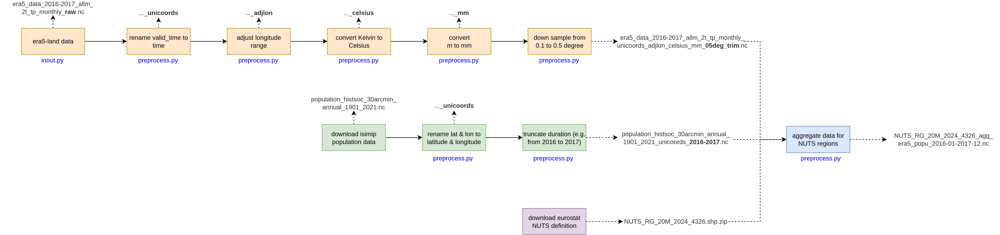

# Data Lake Backend

## Data flowchart
Downloaded data files will go through preprocessing steps as follows:



## Data Lake architecture

The data lake is separated into bronze (raw data), silver (preprocessed data), and gold (processed data). The data preprocessing package deals with levels bronze and silver, and aggregates the gold output of `heiplanet-models` over NUTS regions. The data is stored in `.data_heiplanet_db/bronze`, `.data_heiplanet_db/silver` and `.data_heiplanet_db/gold`.

## Production run

The package defaults are meant for tutorials and integration tests. The settings for the production data are kept separately in `heiplanet_data/production/`:

* `script_config.json`: the datasets to download and the data folders,
* `era5_settings.json`: preprocessing settings for ERA5-Land, monthly and daily,
* `isimip_settings.json`: preprocessing settings for the ISIMIP population data.

To run the download and preprocessing, set up the [CDS API](data.md#set-up-cds-api), activate your environment, and call the script with the production config from the `heiplanet_data` folder:

```bash
cd heiplanet_data
python script.py production/script_config.json
```

Without the argument, the script uses the default `script_config.json`. Please note that the data folders in the config are relative to the working directory, so running the script from a different folder downloads all data again to a new `.data_heiplanet_db` folder. Paths to settings files in the config are relative to the config file.

The production settings differ from the defaults as follows:

| | Default | Production |
|---|---|---|
| ERA5-Land monthly | disabled | enabled |
| ERA5-Land years | 2024 | 2014 to 2018 |
| ERA5-Land grid | resampled to 0.5° | native 0.1° |
| ISIMIP years | 2020 to 2024 | 2014 to 2018 |
| Population density grid | ISIMIP 0.5° grid | ERA5-Land 0.1° grid |

The population density must be on exactly the same grid as ERA5-Land for the subsequent processing in `heiplanet-models`. For this, the `regrid_pop_density` step reads the target grid from the monthly ERA5-Land file in the silver folder. Therefore:

* ERA5-Land has to be processed before the ISIMIP data, which is the order in the script. If the file is missing, preprocessing of the ISIMIP data stops with an error.
* The name of that file depends on the ERA5-Land request. If the request changes, `regrid_pop_density_grid_file` in `production/isimip_settings.json` has to be updated.
* The population file only contains the density, not the population counts.

See [Tutorial B](source/notebooks/tutorial_B_preprocess_data.ipynb) for details on the population density settings.

### Aggregation of model output over NUTS regions

The silver data is the input for `heiplanet-models`, which writes its output (gold) to its own `.data_heiplanet_db/gold` folder. The last step of the script aggregates this output over the NUTS regions. It is configured in the `nuts_aggregation` block of the config, and is only enabled in the production config.

Since the models have to run in between, run this step on its own with `--steps`:

```bash
cd heiplanet_data
python script.py production/script_config.json --steps nuts_aggregation
```

`--steps` takes one or more of `era5`, `era5_daily`, `isimip` and `nuts_aggregation`; steps that are disabled in the config are skipped either way.

The step

* downloads the NUTS shape file (`nuts_file`, from `nuts_url`, checked against `nuts_hash`) to the bronze folder, unless it is already there,
* reads the model output files listed under `datasets` from `data_folder`. In the production config this is `../../heiplanet-models/.data_heiplanet_db/gold/`, i.e. `heiplanet-models` is expected to be checked out next to `heiplanet-data`,
* aggregates the variables listed in `agg` with the given function (area-weighted, via `exactextract`), and only those: R0 of the J-Model and the adult mosquito abundance (`adults`) of the P-Model,
* writes a single NetCDF file with dimensions `NUTS_ID` and `time` to `data_folder_out` (`.data_heiplanet_db/gold/`).

Both variables are averaged rather than summed. The P-Model output is effectively a density, as the model scales every grid cell with a fixed reference area (see [heiplanet-models#86](https://github.com/ssciwr/heiplanet-models/issues/86)). Aggregating the 2014 to 2018 output takes a few minutes.

!!! note "Temporary: P-Model output"
    The P-Model currently writes one file per year, with dimensions `(longitude, latitude, time)` ([heiplanet-models#84](https://github.com/ssciwr/heiplanet-models/issues/84)), which cannot be aggregated directly. Until this is fixed, combine the yearly files first:

    ```bash
    python scripts/pmodel_combine_tmp.py ../heiplanet-models/.data_heiplanet_db/gold 2014 2018
    ```

    This writes `Mosquito_abundance_Global_2014-2018.nc`, the file named in the production config. Note also that the P-Model writes zero instead of NaN for cells it does not solve, which lowers regional means ([heiplanet-models#85](https://github.com/ssciwr/heiplanet-models/issues/85)).
